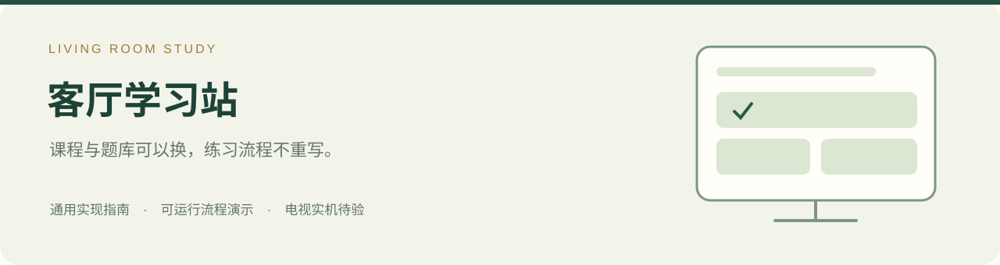
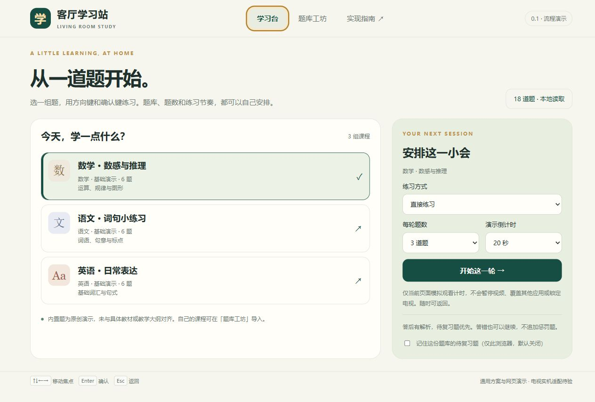

<p align="center"></p>

# 客厅学习站 · Living Room Study

把“电视上做几道题”拆成一套可配置、可验收的家庭学习终端方案。
先在电脑上试课程、题库与答题流程，再按具体安卓电视或电视盒子适配。

**0.1.0-preview.1 · 通用指南＋网页参考实现 · 电视实机待验 · 源码可见／非商业许可**

受“电视答题解锁”相关报道启发，独立实现内容与练习层。
本项目的重点是**题库可以更换、练习过程可解释、接入电视时边界清楚**，
不是视频作者的原始代码，也没有完成对其完整效果的真机复刻。



## 可以直接试什么

- 三组原创演示课程：数学、语文、英语，共 18 题，含答案和解析。
- “直接练习”与“模拟观看 → 倒计时 → 练习 → 本轮记录”两条流程。
- 方向键移动焦点、Enter 确认、Esc 返回；也支持鼠标。
- 题库工坊：本地导入、编辑、校验与导出 JSON，课程与题目分离。
- 待复习题优先，答错仍可继续；每轮有限题数，没有无限追加的惩罚题。
- 默认记录仅留当前页面；可选择在当前浏览器记住该题库的待复习题。

**本版没有 APK，不会覆盖其他应用、锁住电视、替换开机广告或统计外部视频时长。**
倒计时只用于演示当前页面的流程；这些电视系统能力见下一阶段实现指南和验收表。

## 先在电脑上试一轮

到 [Releases](https://github.com/Alex-Wmz/living-room-study/releases) 下载演示 ZIP，
完整解压后，可在支持本地文件的较新 Chrome、Edge 或 Firefox 中打开 `index.html`；
本轮自动浏览器不允许 `file://`，因此此方式尚未实测。建议采用已验证的本机 HTTP 方式。
不需要账号、模型 API、Node.js 依赖或联网题库。

演示 ZIP 内附有 `serve.py`。安装 Python 3.10+ 后，在解压目录运行；**可整段复制执行**：

```powershell
python serve.py
```

如果下载的是源码，则在仓库根使用下面这个入口，**与上面二选一，不要同时启动**：

```powershell
python tools/serve.py
```

看到 `Demo: http://127.0.0.1:8947/` 后，在本机浏览器打开该地址。
该命令持续运行；体验结束后在这个终端按 Ctrl+C 停止。
这个回环地址仅供本机使用，不是电视或异地设备的访问入口。

## 换成自己的课程

在「题库工坊」编辑内置示例或导入自己的 JSON：

1. 每组课程填写学科、学习阶段、单元和内容来源。
2. 每题填写题干、2–4 个选项、从 0 起算的答案序号与解析。
3. 检查通过后应用，先在电脑上跑一轮；再做机型适配。

[题库格式与最小示例](docs/QUESTION_BANK.md) · [可编辑的演示题库](banks/demo.json)

内置题为原创功能演示，未与任何教材版本或年级大纲对齐。
按年龄、课程和进度制作正式题库时，需要人工审核难度、答案、歧义和版权来源。
本项目没有宣称学习效果，也不替代教师或家长的内容判断。

## 从演示到电视，需要哪些工作

[通用实现指南](docs/IMPLEMENTATION.md) 按三个层次说明：

1. **安装与维护**：ADB 或厂商允许的安装渠道，必须由设备本人授权。
2. **内容与流程**：题库、课程、计时状态机、练习结果与退出恢复。
3. **电视系统适配**：原生宿主、开机触发、前台/使用情况权限、覆盖层与系统限制。

同为 Android，手机与电视的部署工具可以相近；电视的权限、后台、遥控器、待机恢复仍须分别验证。
同一品牌也不能代替具体型号、系统版本和固件的验收。
非安卓电视可评估外接安卓盒子，先核对接口与文字清晰度。

[真机验收表](docs/TV_ACCEPTANCE.md) · [复用方案比较与来源](docs/RESEARCH.md)

## 开发与验证

运行代码无第三方依赖。检查需要 Node.js 20+、Python 3.10+。
以下检查均无交互等待，**可整段复制执行**：

```powershell
node --test tests/core.test.cjs
python -m unittest discover -s tests -p "test_*.py"
node tools/check-bank.cjs banks/demo.json
```

发行包通过明确文件清单生成，见 `tools/build_release.py`。
[当前验证记录与接力入口](docs/STATUS.md) 记载浏览器、打包和真机待验范围。
逻辑测试通过不代表电视实机兼容。

## 许可与交流

自有代码、文档和原创示例内容采用 [PolyForm Noncommercial 1.0.0](LICENSE)。
符合许可的非商业用途免费，超出许可允许目的的商业使用须另行书面授权，
适配、题库制作、维护、许可费或分成按具体范围约定：
[商业授权说明](COMMERCIAL_LICENSE.md)。这是源码可见许可，不是 OSI 定义的开源。

普通交流与定制意向可通过 Issues；请只描述通用场景。
安全问题使用 [私密报告](SECURITY.md)。不要公开儿童资料、实际家庭题库、账号或设备调试信息。

维护者负责需求、产品取舍、资料核对与交付验证，实现使用 AI 辅助。
没有复制第三方电视锁源码、新闻视频、教材正文或任何私人设备记录。
